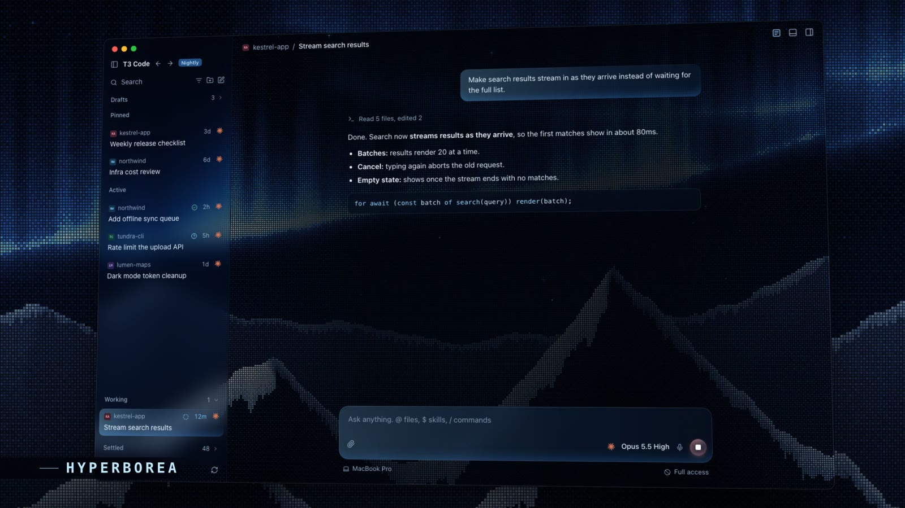

# Hyperborea

Blue northern lights over dithered pixel mountains, for [T3 Code](https://t3.codes). The aurora moves slowly behind the app, and everything else is a little icy.

## Install

Needs a T3 Code build with themes (Nightly, as of November 2026).

**Easiest:** open the [t3skins page](https://www.t3skins.dev/skins/hyperborea), copy the install prompt, and paste it into T3 Code.

**By hand:** copy `theme/hyperborea.json` and `theme/hyperborea.webp` into `~/.t3/userdata/themes/`, then pick Hyperborea in Settings → Appearance.

## What's in here

- `theme/` is the theme itself. `hyperborea.webp` holds 112 aurora frames in an 8×14 grid, and one keyframe animation steps through them in order (14 fps).
- `generator/aurora.py` draws the aurora frames (`python3 aurora.py options.json 112 glacier`). It writes one tall strip. Repack it into the 8×14 grid before shipping, since t3skins shrinks images over 3840 px.
- `video/` is the [Clapper](https://www.npmjs.com/package/@archastro/clapper) project for the preview video. Run `./clap.sh preview` or `./clap.sh render -c hyperborea`.

## Sidebar rows

Each thread in the sidebar shows two lines. The top line has the agent icon, the project icon and name, the machine and the time. The title gets the whole second line. When the sidebar is narrow, the machine name shrinks to just its icon.

T3 Code doesn't offer a stable way to restyle the parts inside a thread row, so this layout depends on how the current Nightly builds that row. A future T3 update could break it. If rows look wrong after an update, open an issue.
