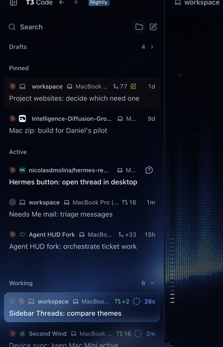

# Idea: two-line sidebar rows

This was tried in November 2026, then set aside in favor of T3 Code's own row layout.

Each thread row became two lines:

- **Top line:** agent icon, project icon and name, machine, badges, status and time
- **Second line:** the title, at full width

When the sidebar was narrow, the machine name and the extra badges shrank to icons.

`two-line-sidebar-rows.css` holds the rules. To try them again, paste them into the theme's `css` at the end, copy the theme into `~/.t3/userdata/themes/`, and switch themes once.

They depend on the inner markup of T3 Code Nightly rows as of `0.1.12-nightly.20261124`. Check them against the current build first.
